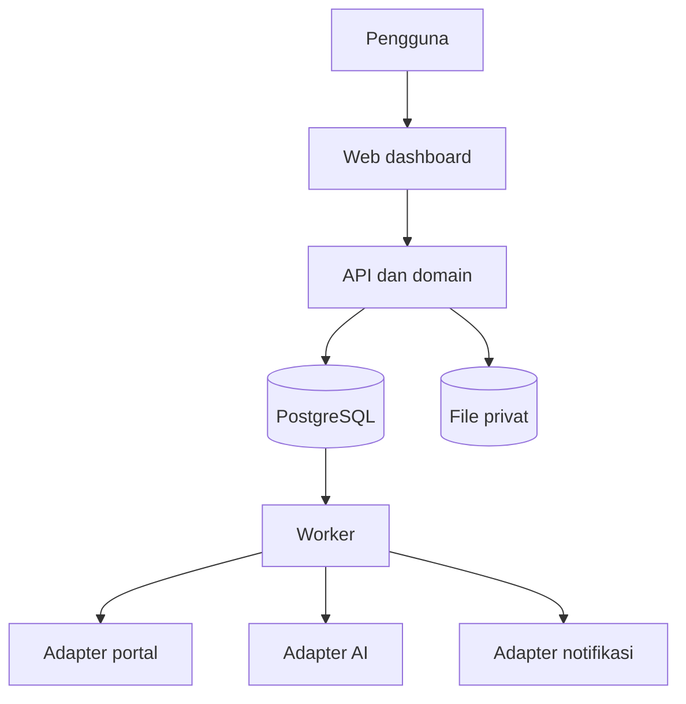

# Technical Requirements Document — AI Job Search Assistant

**Versi:** 0.2 · **Status:** rancangan teknis, belum diimplementasikan  
**Terkait:** [PRD](01-PRD.md) · [Data](05-DBD-Database-Design.md) · [API](06-BSD-Backend-Schema.md) · [Agent](10-AI-Agent-Design.md)

## 1. Pilihan teknologi usulan

| Lapisan | Usulan | Alasan dan batas |
|---|---|---|
| Web/API | Next.js + React + TypeScript pada Node.js LTS | Memudahkan adaptasi dashboard repo pertama; API dan worker dipisah secara proses/logis. Pemilihan final `DEC-02`. |
| Worker | Node.js/TypeScript, proses terpisah | Menjalankan search, AI, browser, export, dan notifikasi tanpa menahan request HTTP. |
| Database/queue | PostgreSQL | Sumber kebenaran dan antrean berbasis row, lease, dan `SKIP LOCKED`; Redis tidak wajib untuk pilot. |
| Browser | Adapter berdasarkan Playwright/Puppeteer; pilih runtime per adapter setelah spike | Kode awal menggunakan lebih dari satu library dan adapter kompatibilitas; jangan menganggap semuanya dapat langsung dipakai. |
| File | Volume privat atau object storage privat kompatibel S3 | Dokumen/CV dan bukti tidak disajikan sebagai URL publik. |
| AI | Adapter OpenAI-compatible, Gemini, Anthropic | Koneksi eksplisit dan berbeda; dukungan lokal tergantung kompatibilitas endpoint dan model. |
| Deployment | Docker Compose di host Linux/homelab | Usulan satu owner; kontainer browser, API, worker, database dan volume diisolasi. |

Versi perangkat lunak dikunci di lockfile/image digest dan ditetapkan saat pengembangan. Ini bukan jaminan bahwa seluruh dependensi upstream aman atau kompatibel.

## 2. Arsitektur dan tanggung jawab

- **Web:** form, dashboard, review bukti, status stream; tidak menyimpan API key atau cookie portal di browser frontend.
- **API/domain:** auth, otorisasi, validasi, persetujuan, transisi state, idempotensi HTTP, audit, dan transaksi database.
- **Worker:** klaim task dan lease, eksekusi terbatas per jenis, rate/budget guard, checkpoint; proses browser terisolasi.
- **Adapter:** menerima input terstruktur, mengembalikan output/eror seragam, dan tidak mengubah status domain secara langsung tanpa perintah aplikasi.
- **Agent:** menyusun draf dan rekomendasi melalui tools terbatas; tidak memiliki izin submit atau membaca file sewenang-wenang.

## 3. Batas modul usulan

`identity`, `candidate`, `documents`, `sources`, `jobs`, `matching`, `research`, `applications`, `browser`, `ai`, `schedules`, `notifications`, `audit`, dan `operations`. Tiap modul memiliki domain/application/infrastructure/interface; pertukaran melalui kontrak publik. Data lintas modul direferensikan dengan ID, bukan saling menulis tabel.

## 4. Integrasi sumber dan browser

Setiap source adapter mendefinisikan `search`, `detail`, kemampuan, akses yang diizinkan, mapper output, timeout, limit, dan fixture. Respons memuat `source`, `externalId`, `canonicalUrl`, `retrievedAt`, dan `rawReference`. Data mentah diperlakukan sebagai tidak tepercaya. Impor manual P0 menerima detail yang ditempel dan URL rujukan opsional. URL masukan disimpan sebagai referensi yang divalidasi dan tidak dipanggil otomatis.

Adapter submit terpisah dan mendeklarasikan identitas akun, target akhir, `inspectForm`, `prepare`, `dispatch`, `observeOutcome`, serta aturan bukti per portal. `inspectForm` hanya menavigasi rute yang telah diuji untuk inspeksi tanpa mengirim data kandidat. Jika formulir tidak dapat diperiksa secara lengkap pada rute itu, arahkan pengguna ke jalur manual. `prepare` hanya menjalankan transfer yang sudah tercantum pada snapshot, misalnya unggah berkas sebelum submit pada tujuan yang sama. Simulasi memakai fixture atau form lokal. Batasi origin, redirect, iframe, request dan akses filesystem proses browser. Untuk rute P1, adapter harus mampu memeriksa tujuan dan data pada batas request keluar, termasuk request yang dipicu oleh handler form. Jika request penting tidak bisa dipetakan ke snapshot, gunakan jalur manual.

Prioritaskan API/akses yang memang diizinkan sumber. Sebelum mengaktifkan browser automation, periksa aturan sumber serta konsekuensinya. CAPTCHA/OTP/challenge memindahkan job ke `needs_user_action`; tidak dipecahkan atau dilewati otomatis. Selector dan halaman live berubah, sehingga keberhasilan suatu portal tidak boleh dijanjikan sebelum pengujian akun nyata yang diotorisasi.

## 5. Konsistensi dan idempotensi

### 5.1 Pencarian dan jadwal

- Satu occurrence jadwal unik menurut `(schedule_id, local_date, local_time)`. Simpan timezone dan waktu UTC yang dipilih. Untuk waktu lokal berulang, gunakan kejadian pertama. Lewati waktu yang tidak ada atau slot yang melewati toleransi keterlambatan. Occurrence, search run dan task dibuat dalam satu transaksi.
- Worker mengklaim row dalam transaksi singkat memakai `FOR UPDATE SKIP LOCKED`, menyimpan `lease_owner`, `lease_until`, dan `lease_token` yang bertambah. Worker memperpanjang lease; hasil dari pemilik/token lama ditolak pada commit.
- Task idempoten seperti search dapat dicoba ulang menurut kebijakan retry dan `next_attempt_at`. Tidak ada transaksi database yang dibuka selama request jaringan/browser.

### 5.2 Submission eksternal

1. Preflight membuat snapshot formulir final yang memuat `application_id`, listing, revisi posting, akun portal, target akhir, form fingerprint, jawaban/consent, hash lampiran, dan daftar transfer sebelum submit. Simpan payload privat dan hash dari serialisasi kanonis. Token CSRF portal dan nonce yang berubah per sesi dikelola di browser. Perbandingan snapshot tetap mencakup perubahan pertanyaan, opsi, field wajib dan nilai akhir yang akan dikirim.
2. Reservasi mengunci application, approval dan target yang terverifikasi dalam transaksi, mencatat attempt, mengonsumsi approval untuk attempt itu, lalu mereservasi kuota. Pastikan satu attempt aktif per application dan satu pengunci pengiriman per target yang diketahui. Catatan manual P0 menyimpan attempt terminal langsung, tanpa approval, dispatch, atau reservation.
3. Worker memeriksa ulang akun, tujuan, formulir, lampiran dan nilai sebelum transfer yang telah disetujui. Worker mengecek ulang hasil akhir tepat sebelum dispatch. Perubahan material, sesi kedaluwarsa, approval dicabut, atau tindakan tambahan di luar snapshot menghentikan attempt sebelum intent. Owner dapat membatalkan submit secara atomik selama intent belum tercatat. Jika unggahan sebelum submit sudah berlangsung, catat efek yang diketahui dan hentikan langkah berikutnya.
4. Transaksi intent mengunci kontrol recovery, application, attempt dan bucket kuota sesuai urutan tetap. Periksa lease/token, snapshot, masa berlaku dan pencabutan approval, status target, dan kuota pada tanggal lokal saat itu. Pindahkan reservasi ke tanggal baru jika perlu. Konversi reservasi menjadi konsumsi pada transaksi yang mencatat `dispatch_intent` permanen. Jika pemeriksaan gagal, simpan hasil sebelum intent dan lepas reservasi.
5. Pemilik intent memanggil dispatch satu kali. Worker recovery tidak menerima ulang izin dispatch. Crash atau lease habis setelah intent tanpa bukti yang memenuhi aturan adapter menjadi `submit_unknown`. Fencing menjaga write database dari worker lama. Browser lama harus dihentikan atau aksesnya dicabut sebelum status negatif setelah intent dapat diverifikasi. Ikuti [Business Spec §7](07-BSD-Business-Spec.md#7-bukti-dan-rekonsiliasi). Satu klik atau riwayat kosong tidak menetapkan hasil.

Jaminan internal dibatasi pada satu intent dan satu pemanggilan dispatch per attempt. Portal tetap menentukan hasil eksternal. Jika bukti negatif terpenuhi, pemilik bisa membuka review baru dengan snapshot dan approval baru. Saat restore, pemeriksaan recovery juga mencakup dispatch setelah checkpoint yang tidak ikut pulih.

Gunakan urutan lock yang sama untuk pembuatan attempt, perubahan kebijakan kuota, hold, revokasi, cancel dan intent. Mulai dengan baris kontrol submit milik owner saat perintah menyentuh guard pengiriman, lalu application, approval/attempt, dan bucket kuota yang diurutkan. Constraint target melindungi insert yang bersaing untuk key yang sama. Uji bahwa hold yang dibuat bersamaan dengan intent menghasilkan satu urutan yang jelas.

### 5.3 API dan outbox

Perintah asinkron atau perubahan status yang dapat dikirim ulang memakai `Idempotency-Key` dengan scope owner, method, dan path resource yang dinormalisasi. Retensi awal yang diusulkan adalah tujuh hari. Request key yang sama dan payload berbeda menghasilkan `409 IDEMPOTENCY_CONFLICT`. Jika masih diproses, kembalikan referensi operasi. Setelah selesai, replay status dan referensi hasil yang masih boleh diakses. Constraint domain tetap berlaku setelah key kedaluwarsa. Simpan perubahan status, audit, dan outbox dalam satu transaksi. Consumer notifikasi memeriksa event key yang sudah diproses.

## 6. AI dan batas kepercayaan

Orchestrator menggabungkan data profil minimum yang telah dikonfirmasi, lowongan yang diperlakukan sebagai data, prompt versi, dan kebijakan provider. Hasil di-parse sebagai schema terstruktur lalu divalidasi. Nilai/angka/dokumen yang tak punya sumber fakta masuk `needs_review`; action berisiko tidak diambil otomatis. Provider, model, token usage bila tersedia, latency, dan versi prompt dicatat tanpa isi CV/prompt. Pengguna memilih transfer data dan fallback lintas provider.

Proteksi terhadap prompt injection berlapis: pemisahan instruksi dan data, pemeriksaan input, izin tool minimal, validasi output, dan review manusia. Tidak ada mekanisme yang menjamin deteksi sempurna. Tool web membatasi URL/protokol dan redirect serta menolak alamat private/internal sesuai kebijakan deployment untuk mengurangi SSRF; pengecualian endpoint model lokal dikelola admin secara eksplisit dan terpisah dari URL lowongan.

## 7. Keamanan dan privasi

- Provisioning owner dilakukan lewat CLI lokal dengan akses operator. Migration menyiapkan singleton untuk dikunci saat membuat owner dalam satu transaksi. Proses HTTP mulai dari halaman login setelah provisioning. Sesi memakai HttpOnly, Secure saat HTTPS, SameSite, token CSRF pada mutasi, rate limit login, rotasi sesi, dan pemeriksaan owner.
- Secret provider disimpan terenkripsi menggunakan kunci master di luar database; API hanya mengembalikan status konfigurasi dan nilai termask, bukan secret. Kunci master dan volume browser dilindungi; rencana rotasi/recovery wajib diuji.
- Allowlist origin yang spesifik; tidak ada `Access-Control-Allow-Origin: *` untuk API privat; jangan mempublikasikan dashboard langsung ke internet.
- Proteksi upload berdasarkan ukuran, tipe, pemeriksaan konten, nama acak, dan penyimpanan privat; file tidak dieksekusi, unduhan hanya melalui endpoint terotorisasi.
- Log terstruktur tidak berisi token, cookie, prompt lengkap, CV, isi email, atau jawaban sensitif. Kebijakan retensi dipilih pemilik.
- Ekspor dan purge menggunakan task privat dengan versi data owner. Penghapusan menarik akses dokumen dan ekspor, mencabut approval terdampak sebelum intent, dan menghentikan publikasi hasil worker yang memakai versi lama. Penghapusan file yang masih dibutuhkan attempt aktif menghasilkan konflik. Lihat [Backend Schema §7](06-BSD-Backend-Schema.md#7-ekspor-dan-penghapusan-data).

## 8. Operasional dan SLO awal

Sediakan endpoint health terpisah untuk liveness/readiness, heartbeat worker, metrik backlog, kegagalan dan durasi task, kuota, `submit_unknown`, dan penahanan submit setelah restore. Target SLO kuantitatif ditentukan setelah baseline. Backup mencakup database, dokumen dan konfigurasi yang diperlukan. Simpan kunci dekripsi terpisah. Proses restore dimulai dengan submit browser nonaktif pada runtime dan membuat catatan penahanan sebelum worker dapat kembali online. Jalankan [runbook restore](12-Deployment-Security-Operations.md#6-backup-dan-restore) sebelum mengaktifkan kembali dispatch.

## 9. Nonfungsional dan keterbatasan

Single owner, satu instance worker secara default; desain lease tetap mendukung beberapa worker setelah diuji. Dukungan GUI login pada server membutuhkan sesi browser/display aman, dan login/2FA dapat kedaluwarsa. Jalur model eksternal memerlukan koneksi dan dapat menimbulkan biaya. Startup tidak boleh menjalankan submit secara otomatis; scheduler hanya aktif setelah dikonfigurasi. Detail: [Operations](12-Deployment-Security-Operations.md).
