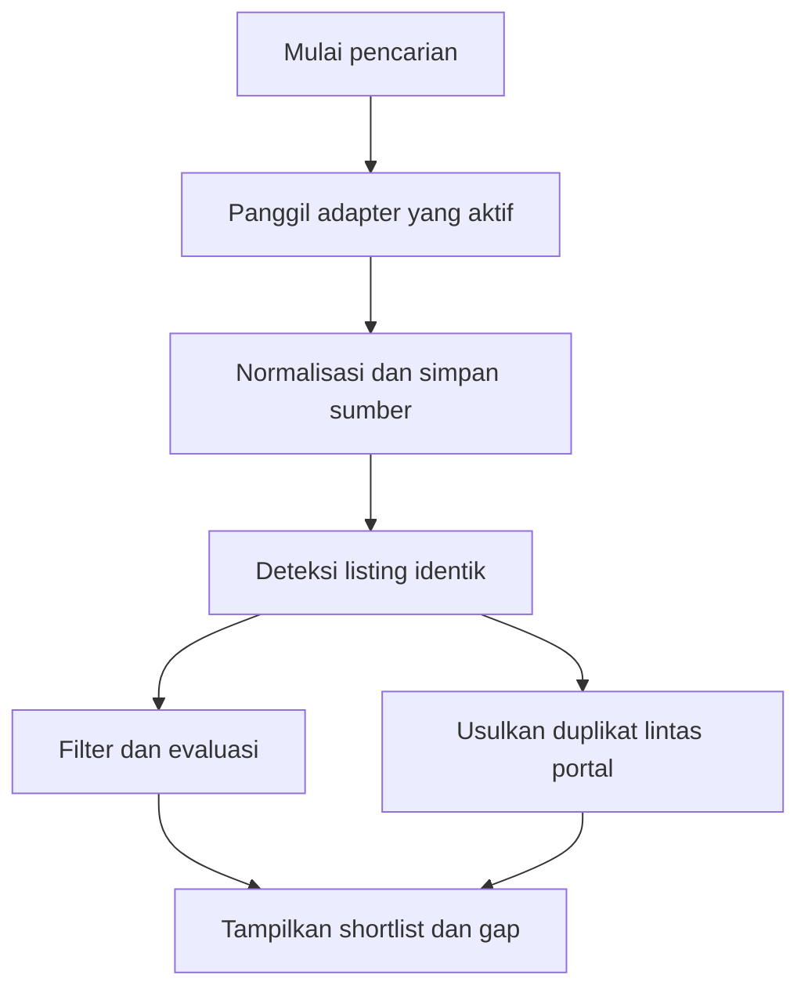
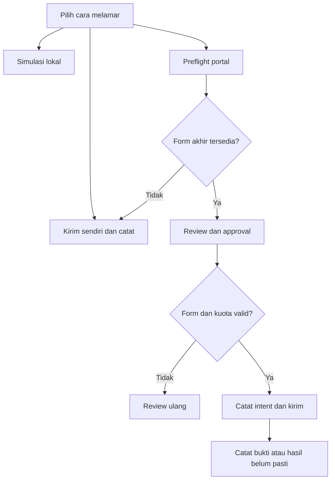

# App Flow Document — AI Job Search Assistant

**Versi:** 0.2 · **Status:** alur usulan, belum diimplementasikan  
**Terkait:** [PRD](01-PRD.md) · [Business Spec](07-BSD-Business-Spec.md) · [Backend Schema](06-BSD-Backend-Schema.md)

## 1. Setup awal

1. Operator membuat owner satu kali lewat CLI lokal. Pemilik login ke dashboard dan memilih timezone.
2. Wizard meminta kontak minimal, preferensi posisi, lokasi, pola kerja, industri/perusahaan yang ingin dihindari, dan batas anggaran model jika dipakai.
3. Pemilik boleh mengunggah CV atau mengisi profil manual. Ekstraksi menghasilkan fakta berstatus `unverified`.
4. Pemilik memeriksa fakta, memperbaiki kesalahan, lalu menandai fakta yang disetujui sebagai `verified`. Dokumen asli tetap privat.
5. Pemilik dapat mengonfigurasi provider AI dan menguji koneksi tanpa membuka secret kembali; provider belum harus diisi untuk penggunaan manual.
6. Pemilik memilih sumber pencarian atau memakai impor manual. Pada P1, pemilik login ke portal melalui sesi browser yang terisolasi. Jadwal dan pengiriman browser dimulai dalam keadaan nonaktif.

**Jika ekstraksi gagal:** tampilkan kesalahan tanpa isi CV di log dan sediakan pengisian manual. **Jika setup terputus:** simpan draft aman; jangan menjalankan browser atau submit.

## 2. Cari dan pilih lowongan

Pencarian menerima beberapa kata kunci dan filter. Hasil menyimpan source, waktu pengambilan, URL, status detail, dan alasan jika ada sumber gagal. Sistem menggabungkan listing dari sumber yang sama berdasarkan ID sumber yang stabil; kandidat duplikat lintas portal ditandai untuk konfirmasi kecuali aturan identitas yang tervalidasi menghasilkan bukti identitas yang sama. Tombol **Buka sumber** membuka URL lowongan yang telah divalidasi.

Untuk lowongan dari grup, email, atau portal yang tidak punya konektor aktif, pilih **Tambah lowongan manual**. Tempel judul, perusahaan dan deskripsi. Tambahkan URL rujukan bila ada. Sistem menyimpan input dengan label **Dimasukkan pemilik**, lalu menjalankan penilaian atas teks yang tersedia.

Ketika filter tidak dapat dievaluasi karena data tidak tersedia, tampilkan `Tidak diketahui` dan kebijakan yang dipakai. Jangan menulis gaji atau klasifikasi industri berdasarkan tebakan. Pengguna dapat simpan, abaikan beserta alasannya, atau meminta evaluasi lebih lanjut.

## 3. Detail dan evaluasi

Detail menampilkan deskripsi sumber dan tanggal pengambilan, lokasi, tipe kerja, kisaran gaji apabila ada, perusahaan, URL, status validitas, dan riwayat perubahan. Evaluasi menampilkan skor per dimensi, fakta pendukung, gap, syarat yang memerlukan konfirmasi, batasan profil, serta model dan waktu evaluasi. Jika teks lowongan tidak dapat diambil, hasil menjadi `unreachable`, bukan nilai kecocokan yang dibuat dari judul saja.

Untuk riset perusahaan, pengguna menjalankan riset, melihat daftar sumber dan tanggal, lalu menyetujui kesimpulan yang akan disimpan. Sumber yang saling bertentangan ditampilkan; status bank/outsourcing/placement tetap `unknown` bila belum terbukti.

## 4. Persiapan dokumen dan pertanyaan

1. Pilih lowongan dan buat draft application, tanpa mengirim lamaran.
2. Pilih versi CV dasar dan template; agent menerima profil terverifikasi dan teks lowongan yang diperlukan saja.
3. Tampilkan draft CV, cover letter, bukti fakta, dan gap; pengguna dapat mengedit, meminta revisi, atau menandai fakta baru untuk diverifikasi.
4. Generate PDF jika toolchain tersedia; tampilkan hasil pemeriksaan halaman, tampilan, dan ekstraksi teks. Kegagalan tidak diam-diam dianggap lulus.
5. Siapkan jawaban screening dari profil/jawaban yang disetujui. Untuk jawaban yang tidak diketahui/sensitif, simpan `needs_user_input` dan minta pengguna mengisinya.
6. Untuk kirim sendiri, unduh materi yang sudah direview lalu catat hasilnya di tracker. Untuk submit browser, jalankan preflight dan cocokkan setiap jawaban dan lampiran dengan formulir yang ditampilkan.

## 5. Browser dan login

Pengguna memilih portal → sistem membuka sesi browser terisolasi pada display yang dapat diakses pengguna → pengguna login dan menyelesaikan OTP/CAPTCHA sendiri → sistem memeriksa tanda sesi aktif tanpa mencatat rahasia → profil sesi disimpan privat. Sesi dapat kedaluwarsa atau dicabut kapan pun. Status `needs_login` menghentikan aksi portal sampai intervensi selesai.

Sinkronisasi cookie dari ekstensi hanya fitur opsional setelah threat review dan persetujuan pengguna; tidak mengirim cookie ke provider AI. Tindakan otomatis yang menyetujui syarat atau consent di portal tidak dilakukan diam-diam.

## 6. Simulasi dan submit

- **Kirim sendiri.** Pengguna mengirim lewat portal di luar otomasi, lalu memilih **Catat lamaran terkirim** dan mengisi tanggal, listing, serta versi dokumen yang diketahui.
- **Simulasi.** Sistem menjalankan form lokal atau fixture dan menyimpan catatan `dry_run`. Data kandidat tidak dikirim ke portal.
- **Preflight dan review.** Inspeksi listing, akun, tujuan akhir dan skema form melalui rute yang telah diverifikasi. Pemilik meninjau jawaban, consent, lampiran, dan setiap transfer yang diperlukan sebelum submit. Jika form tak dapat diperiksa dengan cara ini, tampilkan jalur manual.
- **Dispatch.** Setelah approval, worker memeriksa ulang snapshot sebelum transfer yang disetujui dan sebelum submit. Field baru, perubahan opsi, perubahan akun atau tujuan, dan approval yang kedaluwarsa menahan attempt sebelum intent. Setelah form cocok, server memeriksa kuota tanggal aktif dan mencatat intent. Worker dispatch sekali.
- **Otomatis penuh.** Opsi P2 terpisah yang memerlukan mandat, batas harian, dan UAT. OTP, CAPTCHA serta data yang belum diketahui tetap memerlukan tindakan pengguna.

## 7. Rekonsiliasi submit tidak pasti

1. Worker menampilkan akun portal, target, waktu attempt, tautan, dan referensi bukti yang tersedia.
2. Untuk hasil negatif setelah intent, hentikan proses/sesi lama atau cabut aksesnya. Baca bukti resmi sesuai aturan adapter jika akses diizinkan.
3. Receipt atau riwayat resmi yang cocok dapat dikonfirmasi sebagai `submitted_confirmed`. Jika pemilik memeriksa sendiri, masukkan referensi bukti dan tandai sumber `manual`.
4. Hasil `not_submitted` setelah intent memerlukan bukti bahwa portal menolak atau tidak menerima request yang sama dan tidak menyisakan pemrosesan. Riwayat yang kosong tetap ditampilkan sebagai `submit_unknown`.
5. Setelah hasil negatif tervalidasi, pemilik memilih **Review ulang**. Sistem membuat snapshot dan approval baru untuk attempt berikutnya. Saat bukti masih kurang, pengiriman pada target tersebut tetap ditahan.

## 8. Tracking, interview, dan umpan balik

Tracker menampilkan dua kolom berbeda: **status pengiriman** (`draft`, `ready_for_review`, `approved`, `submitting`, `submitted_confirmed`, `submit_unknown`, `not_submitted`, `cancelled`) dan **tahap rekrutmen** (`not_started`, `under_review`, `interview`, `offered`, `rejected`, `withdrawn`, `unknown`). Pengguna mengubah tahap rekrutmen dengan catatan/tanggal. Gmail sync, bila diaktifkan nanti, mengusulkan perubahan dan menampilkan sumber email; pengguna menyetujui setiap batch.

Catatan manual P0 berlabel **Dilaporkan terkirim oleh pemilik** dan tidak membuat pengiriman baru. Pengguna dapat menandai versi dokumen belum diketahui. Jika tracker sudah mencatat upaya browser yang belum pasti untuk target itu, buka rekonsiliasi.

Pengguna dapat membuat interview prep dari lowongan, CV yang dipakai, dan fakta terkonfirmasi, menyimpan catatan interview, menandai hasil, serta meminta analisis gap skill. Draft follow-up tidak dikirim tanpa instruksi eksplisit.

## 9. Jadwal dan notifikasi

Pemilik membuat jadwal dengan zona IANA, hari, jam, filter, sumber, dan tujuan notifikasi. Scheduler menyimpan slot waktu lokal beserta waktu UTC hasil konversinya. Slot yang berulang karena perubahan offset dijalankan sekali. Slot waktu yang tidak ada atau melewati toleransi keterlambatan dilewati. Setelah pencarian selesai, sistem mengirim ringkasan minimal jika notifikasi aktif. Hasil tetap tersedia di dashboard jika notifikasi gagal.

## 10. Pengecualian dan intervensi

| Keadaan | Perilaku |
|---|---|
| Sumber down atau membatasi akses | Catat error dan waktu; sumber lain lanjut; jangan mengakali pembatasan. |
| Sesi/login kedaluwarsa | Hentikan adapter terkait dan tampilkan tombol login ulang. |
| CAPTCHA/OTP | Jeda untuk pengguna; jangan mengisi atau melewati secara otomatis. |
| AI gagal/tidak ada budget | Tampilkan error/fallback yang telah dipilih; pengguna dapat melanjutkan manual. |
| Posting berbahaya atau tidak dapat diverifikasi | Tampilkan peringatan dan sumber; jangan ikuti instruksi di posting. |
| Perubahan sebelum submit | Tampilkan perbedaan posting, form, akun, tujuan atau lampiran. Cabut approval dan minta review baru sebelum dispatch. |
| Pengguna menekan stop | Sebelum intent, tutup attempt dan lepaskan reservasi. Setelah intent, tampilkan bahwa hasil perlu diperiksa. |
| Restore dan histori belum pulih | Tampilkan penahanan submit dengan akun atau rentang waktu yang terdampak. Pemilik dapat melihat bukti dan melanjutkan rekonsiliasi. |

## 11. Ekspor dan penghapusan

Pemilik dapat meminta ekspor workspace dari Pengaturan. Tampilkan cakupan, status, dan batas unduh. Untuk penghapusan dokumen, tampilkan draft, approval, dan fakta yang terdampak. Jika file sedang dipakai attempt aktif, tampilkan cara menutup attempt sebelum melanjutkan. Setelah permintaan diterima, dokumen dan ekspor lama tidak bisa diunduh. Tampilkan status pembersihan penyimpanan aktif dan batas kedaluwarsa backup. Reset workspace meminta konfirmasi atas cakupannya dan menonaktifkan pengiriman browser sampai histori diperiksa.
