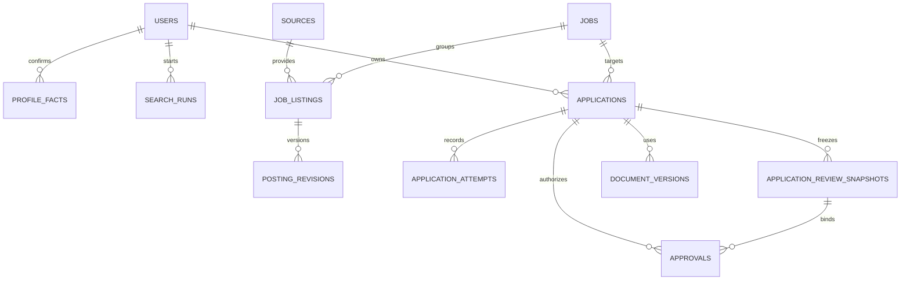

# Database Design Document — AI Job Search Assistant

**Versi:** 0.2 · **DBMS usulan:** PostgreSQL · **Status:** rancangan logis, bukan migration siap produksi  
**Terkait:** [TRD](02-TRD.md) · [API](06-BSD-Backend-Schema.md) · [Business Spec](07-BSD-Business-Spec.md)

## 1. Prinsip dan notasi

UUID untuk ID; `timestamptz` UTC; tanggal lokal dihitung memakai zona IANA yang disimpan dalam preferensi/jadwal. Nominal gaji disimpan `numeric` bersama mata uang dan satuan periode; rentang tidak dinormalisasi tanpa data yang cukup. `owner_id` membatasi kepemilikan, termasuk instalasi single owner. Berkas sensitif ada dalam storage privat, database menyimpan referensi dan hash, bukan URL publik atau cookie mentah.

`PK`, `FK`, `UQ` dan `IDX` di bawah adalah rancangan constraint/index. Semua write yang mengubah application/attempt wajib memeriksa versi dan state dalam transaksi. Field `created_at`, `updated_at`, dan audit actor dapat ditambahkan konsisten pada tabel yang memerlukannya.

## 2. Relasi inti

## 3. Identitas, profil, dan file

| Tabel | Kolom penting | Constraint dan catatan |
|---|---|---|
| `installation_owner` | `slot`, `owner_id`, `provisioned_at` | Satu baris `slot = 1` disediakan migration. CLI mengunci baris, membuat user dan mengisi owner secara atomik. |
| `users` | `id`, `email`, `password_hash`, `status`, `timezone`, `privacy_generation` | UQ email normalisasi. Generasi privasi bertambah saat penghapusan untuk menolak publikasi hasil lama. |
| `sessions` | `id`, `owner_id`, `token_hash`, `expires_at`, `revoked_at` | Hanya hash token; index expiry dan owner. |
| `candidate_profiles` | `id`, `owner_id`, `display_name`, `preferences_json`, `version` | UQ owner pada pilot; JSON bukan sumber fakta yang tidak terdokumentasi. |
| `profile_facts` | `id`, `owner_id`, `type`, `current_version_id`, `verification_status` | Status `unverified/verified/retracted`. Owner mengonfirmasi fakta. |
| `profile_fact_versions` | `id`, `fact_id`, `version_no`, `value_ref`, `source_document_id`, `verified_at`, `created_at` | UQ fact dan versi. Referensi nilai privat dapat ditarik saat penghapusan. |
| `documents` | `id`, `owner_id`, `kind`, `object_key`, `media_type`, `sha256`, `size`, `status`, `version` | Object key privat. Status `active/deleting/deleted` mengatur baca dan unduh. Versi digunakan pada penghapusan bersyarat. |
| `document_versions` | `id`, `owner_id`, `application_id`, `document_id`, `kind`, `version_no`, `content_hash`, `template_id`, `fact_version_ids`, `created_at` | UQ application, kind dan versi. Isi terversi bersifat immutable selama tersedia. Saat purge, cabut isi dan sisakan ID/status penghapusan bila histori masih merujuk versi itu. |
| `answer_bank` | `id`, `owner_id`, `question_key`, `answer_ciphertext`, `source_fact_ids`, `verification_status` | Jawaban sensitif terenkripsi jika disimpan; tidak otomatis dipakai bila belum diverifikasi. |

## 4. Lowongan, run, dan penilaian

| Tabel | Kolom penting | Constraint dan catatan |
|---|---|---|
| `sources` | `id`, `code`, `adapter_version`, `enabled`, `capabilities_json`, `access_policy` | UQ code; informasi per source tidak menjamin layanan mengizinkan semua mode. |
| `jobs` | `id`, `owner_id`, `company_normalized`, `title_normalized`, `location`, `status` | Representasi yang dikurasi; status listing dan status pengguna tidak digabung. |
| `job_listings` | `id`, `owner_id`, `job_id`, `source_id`, `external_id`, `canonical_url`, `current_revision_id`, `retrieved_at`, `posting_status` | UQ owner, source dan external ID saat ID stabil tersedia. Impor manual memakai source lokal `manual` dengan URL rujukan opsional. Fingerprint kemiripan menghasilkan usulan duplikat. |
| `posting_revisions` | `id`, `listing_id`, `content_hash`, `content_ref`, `retrieved_at`, `provenance` | Versi konten untuk evaluasi, interview dan review formulir. Provenance membedakan adapter dengan teks yang dimasukkan pengguna. |
| `duplicate_suggestions` | `id`, `owner_id`, `left_job_id`, `right_job_id`, `confidence`, `reason`, `resolution` | Pasangan dinormalisasi, UQ owner + pasangan; keputusan manual diaudit. |
| `search_runs` | `id`, `owner_id`, `query_snapshot`, `status`, `started_at`, `finished_at`, `schedule_occurrence_id` | Track hasil per source; source timeout tidak menghapus hasil sukses lain. |
| `search_run_sources` | `id`, `run_id`, `source_id`, `status`, `counts`, `error_code` | UQ `(run_id, source_id)`; tidak menyimpan token/isi sensitif pada error. |
| `search_run_listings` | `run_id`, `listing_id`, `posting_revision_id`, `seen_at` | UQ run dan listing. Menjaga hasil setiap run walau listing muncul lagi. |
| `match_evaluations` | `id`, `owner_id`, `job_id`, `profile_version`, `posting_revision_id`, `rubric_version`, `score_json`, `gaps_json`, `source_refs`, `model`, `status` | Simpan versi input, alasan, sumber dan skor nullable. |
| `company_research` | `id`, `owner_id`, `job_id`, `summary`, `claims_json`, `checked_at`, `status` | Setiap klaim memiliki source URL dan status verifikasi; kosong jika tidak diketahui. |

## 5. Aplikasi, persetujuan, dan bukti

| Tabel | Kolom penting | Constraint dan catatan |
|---|---|---|
| `applications` | `id`, `owner_id`, `job_id`, `submission_status`, `recruitment_stage`, `current_version` | UQ `(owner_id, job_id)` untuk satu rekam lamaran per pekerjaan terkonfirmasi; catatan sejarah/attempt terpisah. Jika dua job kemudian digabung, selesaikan konflik secara eksplisit sebelum merge. |
| `application_answers` | `id`, `application_id`, `question`, `answer_ref`, `source_fact_ids`, `verification_status`, `version` | Snapshot immutable atau versioned; konten sensitif dilindungi dan tidak dilog. |
| `application_review_snapshots` | `id`, `owner_id`, `application_id`, `listing_id`, `posting_revision_id`, `portal_account_id`, `target_key`, `form_fingerprint`, `content_ref`, `snapshot_hash`, `captured_at`, `valid_until`, `invalidated_at` | Isi yang disetujui mencakup tujuan akhir, jawaban/consent, versi dan hash lampiran serta transfer yang direncanakan. Payload privat. Pencabutan atau purge menutup penggunaan snapshot. |
| `approvals` | `id`, `application_id`, `owner_id`, `snapshot_id`, `approved_at`, `expires_at`, `revoked_at`, `consumed_at` | Waktu konsumsi diisi saat reservasi. Pencabutan dan kedaluwarsa masih diperiksa sebelum intent. |
| `application_attempts` | `id`, `owner_id`, `application_id`, `approval_id`, `listing_id`, `portal_account_id`, `target_key`, `mode`, `state`, `version`, `dispatch_intent_at`, `dispatch_owner`, `reported_submitted_at`, `material_ref`, `finished_at`, `confirmation_source`, `confirmation_ref`, `error_code` | Mode `manual`, `dry_run` atau `review_before_submit` untuk pilot. UQ approval non-null. Manual dan dry-run tidak punya intent atau reservasi. `material_ref` dapat menyimpan referensi versi dokumen manual tanpa menggandakan blob. |
| `attempt_evidence` | `id`, `attempt_id`, `kind`, `provider_ref`, `source`, `object_key`, `policy_version`, `reviewer_note`, `captured_at` | Bukti privat dan terkait attempt, target serta akun. Catatan rekonsiliasi manual tidak berisi CV/secret; retensi dan redaksi mengikuti kebijakan. |
| `application_events` | `id`, `application_id`, `attempt_id`, `event_type`, `from_state`, `to_state`, `actor_type`, `actor_id`, `reason_code`, `occurred_at` | Append-only pada alur normal. Event tahap rekrutmen dan pengiriman dibedakan. |
| `quota_buckets` | `id`, `owner_id`, `scope`, `scope_key`, `local_date`, `policy_version`, `reserved_count`, `consumed_count` | UQ `(owner_id, scope, scope_key, local_date)`. `scope_key` wajib terisi, termasuk bucket global. Versi kebijakan adalah metadata. Counter nonnegatif. |
| `quota_reservations` | `id`, `attempt_id`, `global_bucket_id`, `source_bucket_id`, `reserved_at`, `consumed_at`, `timezone`, `state` | UQ attempt. Gunakan kedua bucket dalam transaksi. Sebelum intent, reservasi boleh dipindahkan ke tanggal aktif atau dilepas. Setelah intent, konsumsi tetap tercatat. |
| `interview_packs` | `id`, `owner_id`, `application_id`, `posting_revision_id`, `document_version_ids`, `content_ref`, `status` | Prep pack privat. Versi input mengikuti catatan lamaran. |

**Keunikan attempt aktif.** Gunakan partial unique index pada `application_id` untuk `state IN ('reserved','running','submitting')` pada submit browser. Untuk target yang dapat diidentifikasi, tambah partial unique index pada `(owner_id, target_key)` untuk mode browser/manual dan state aktif, `submit_unknown`, atau `submitted_confirmed`. Key stabil berasal dari identitas requisition dan namespace tujuan yang diverifikasi adapter. Jika dua listing diketahui memiliki target yang sama, arahkan konflik ke review canonical job. Transisi domain di bawah lock juga memeriksa application, approval, dan penahanan recovery. Catatan manual menyimpan versi dokumen yang diketahui sebagai referensi attempt privat dengan penanda bila versi tidak tersedia.

## 6. Integrasi, jadwal, dan queue

| Tabel | Kolom penting | Constraint dan catatan |
|---|---|---|
| `portal_accounts` | `id`, `owner_id`, `source_id`, `label`, `encrypted_profile_ref`, `session_state`, `last_checked_at` | Profil browser di volume privat; tidak menyimpan password portal plaintext. |
| `ai_providers` | `id`, `owner_id`, `type`, `base_url`, `model`, `secret_ciphertext`, `enabled` | API hanya mengembalikan status dan mask; master key terpisah dari DB. |
| `saved_searches` | `id`, `owner_id`, `filters_json`, `source_codes`, `version` | Jadwal merujuk konfigurasi pencarian. Setiap run menyimpan snapshot versi yang dipakai. |
| `schedules` | `id`, `owner_id`, `timezone`, `rule`, `search_config_id`, `enabled` | FK search config ke `saved_searches`. Simpan aturan slot waktu lokal dan zona IANA. |
| `schedule_occurrences` | `id`, `schedule_id`, `local_date`, `local_time`, `timezone`, `scheduled_for_utc`, `state` | UQ jadwal, tanggal lokal dan jam lokal. UQ `search_runs.schedule_occurrence_id` bila ada. |
| `tasks` | `id`, `kind`, `payload_ref`, `state`, `available_at`, `lease_owner`, `lease_until`, `lease_token`, `attempt_count`, `idempotency_key` | IDX state/available; payload tidak memuat CV/secret; retry submit tunduk aturan unknown. |
| `outbox_events` | `id`, `event_key`, `type`, `payload_ref`, `published_at` | UQ event key; pencatatan atomik bersama perubahan domain. |
| `notification_channels` | `id`, `owner_id`, `provider`, `destination_ref`, `secret_ciphertext`, `enabled` | Kredensial write-only dan tujuan privat. |
| `notifications` | `id`, `owner_id`, `event_key`, `channel_id`, `status`, `sent_at` | UQ owner, channel dan event. Idempotensi internal menjaga retry di sisi aplikasi. |
| `submission_controls` | `owner_id`, `browser_enabled`, `quota_timezone`, `global_limit`, `source_limits`, `policy_version`, `version` | Satu baris per owner. Default browser disabled. Reservasi, intent, perubahan limit dan hold memakai lock atas baris ini. |
| `submission_recovery_holds` | `id`, `owner_id`, `scope`, `scope_key`, `checkpoint_at`, `window_end_at`, `status`, `evidence_ref`, `coverage_started_at`, `coverage_ended_at`, `resolution_note`, `resolved_by`, `resolved_at`, `version` | Jendela dapat memiliki batas akhir belum diketahui. Runtime restore membuat hold sebelum worker aktif. Pelepasan menyimpan cakupan, referensi bukti dan pemeriksa; browser tetap nonaktif. Reservasi dan intent memeriksa hold dengan lock kontrol owner. |
| `privacy_requests` | `id`, `owner_id`, `kind`, `scope`, `resource_id`, `generation`, `status`, `artifact_ref`, `expires_at`, `backup_expires_at` | Ekspor dan purge asinkron. Hanya artefak siap, belum kedaluwarsa dan generasinya masih valid yang dapat diunduh. |
| `idempotency_records` | `owner_id`, `method`, `route`, `key`, `request_hash`, `operation_id`, `response_ref`, `expires_at` | UQ gabungan scope+key; masa simpan 7 hari usulan. |
| `audit_events` | `id`, `owner_id`, `actor`, `action`, `entity_type`, `entity_id`, `result`, `request_id`, `occurred_at` | Tidak menyimpan token, body CV, cookie, atau jawaban sensitif. |

## 7. Indeks dan invariant lintas tabel

1. Index listing pada source/external ID, `jobs(owner_id, status)`, application owner/status, attempts application/time, tasks state/available time, dan audit entity/time. Tambah index berdasarkan hasil pengukuran, bukan dugaan semata.
2. `submitted_confirmed` memerlukan attempt dengan sumber konfirmasi dan bukti sesuai BR-12. Mode manual membuat attempt terminal melalui perintah tersendiri. Dry-run hanya menyimpan catatan simulasi.
3. `submit_unknown` melarang retry otomatis. Rekonsiliasi dicatat sebagai event dan bukti baru; tidak menghapus attempt sebelumnya. Setelah intent, counter kuota tetap terpakai untuk semua hasil.
4. Penggabungan canonical jobs mempertahankan semua listing, evaluasi, dan riwayat; bila keduanya sudah punya application, berhenti untuk penyelesaian manual.
5. Snapshot dan approval terversi. Setiap perintah reservasi, intent, pembatalan dan rekonsiliasi menyimpan perubahan terkait, audit dan outbox dalam satu transaksi. Gunakan lock sebelum memeriksa hold, approval, target dan bucket. Lepas lock sebelum panggilan eksternal.
6. Penghapusan mencabut akses dan generasi ekspor segera. Purge menangani blob, cache, ekspor dan payload privat yang merujuk data. Pertahankan metadata audit minimum sesuai kebijakan dan batalkan snapshot/approval terdampak. Lihat [API §7](06-BSD-Backend-Schema.md#7-ekspor-dan-penghapusan-data).
7. Catat intent dan konsumsi kuota pada tanggal lokal aktif secara atomik. Intent tidak berpindah ke worker recovery. Bukti negatif setelah intent baru dapat diterima setelah sesi lama dihentikan atau akses dicabut dan bukti portal memenuhi BR-14.
8. Gunakan FK dan pemeriksaan owner untuk hubungan dokumen, snapshot, approval, attempt, akun dan listing. Migrasi harus menguji input yang mencoba mengikat resource dengan owner yang berbeda.
